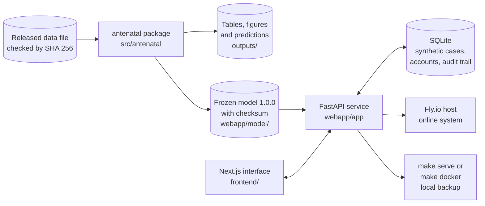
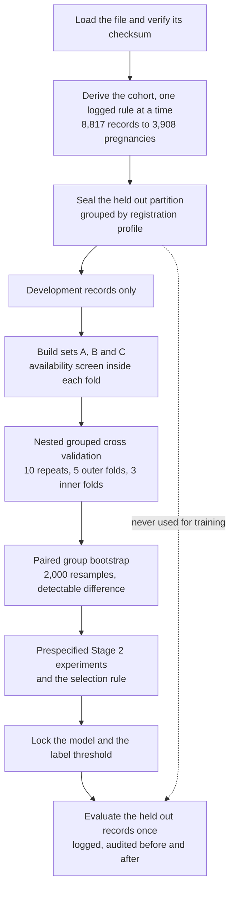
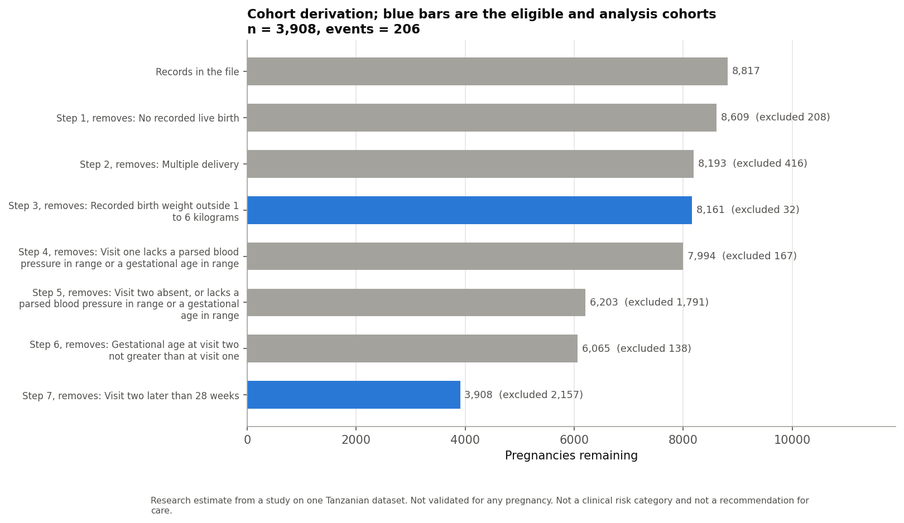
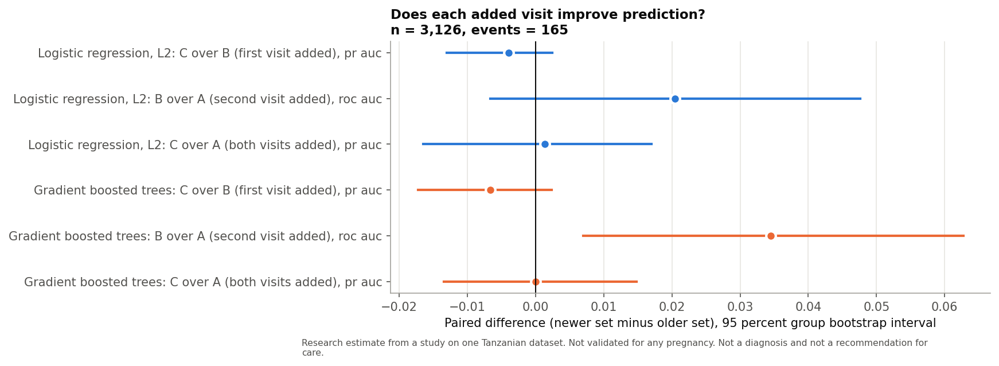
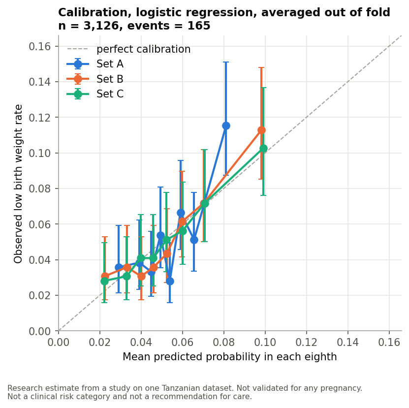
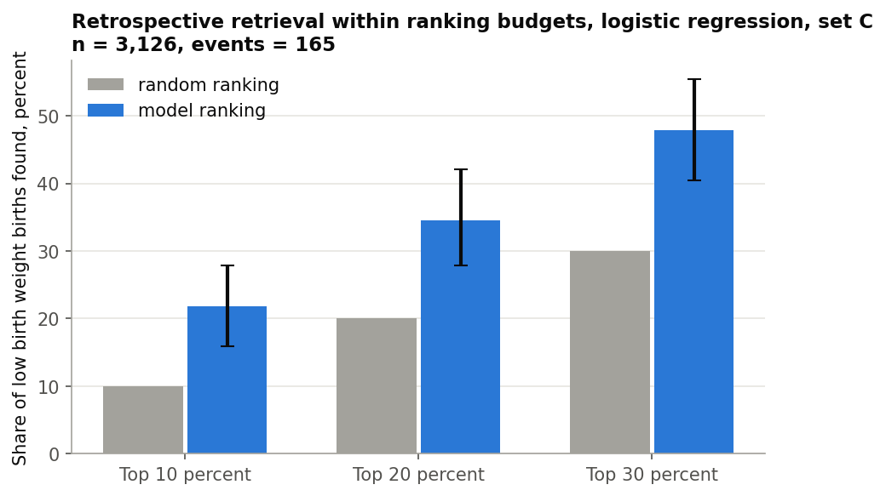
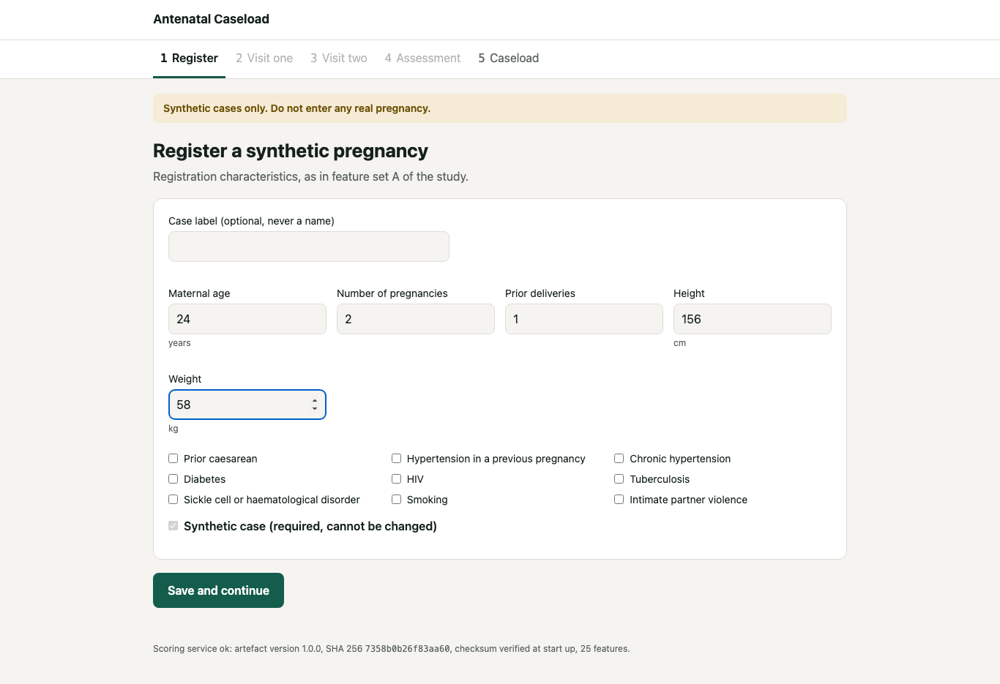
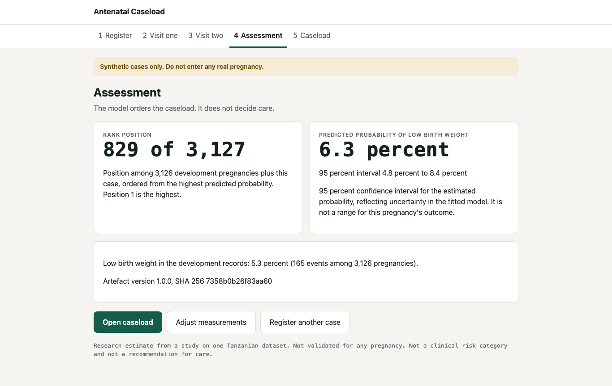
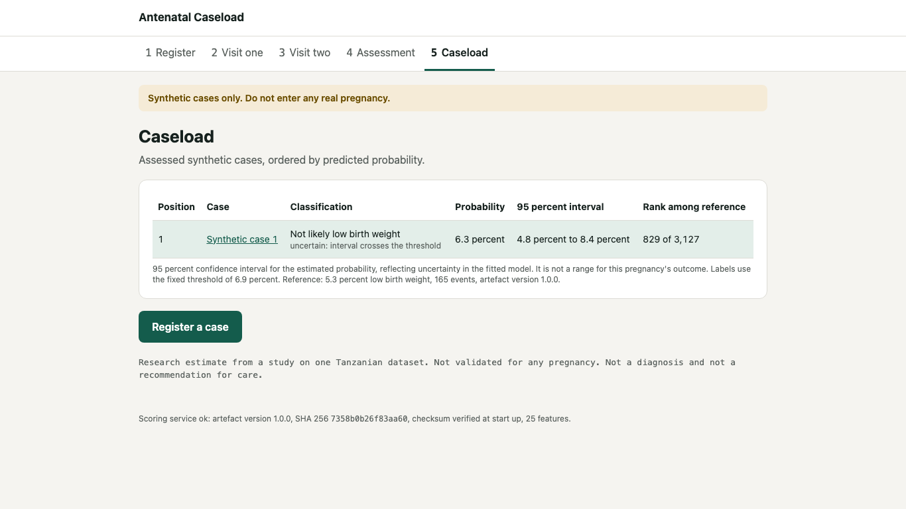

# Antenatal caseload prediction

### Incremental predictive value of two antenatal visits for recorded low birth weight

[](https://github.com/Kelvin364/Antanental_risk_model/actions/workflows/ci.yml)
[](LICENSE)

Kelvin Rwihimba, BSc Software Engineering, African Leadership University. Supervisor: Emmanuel Adjei.

> **Research code. The prototype accepts synthetic cases only. It is not a medical device and must not be used for any real pregnancy.**

| | |
| --- | --- |
| Demonstration video | https://youtu.be/QN0X9P8TFkA |
| Technical report | [Technical Report (PDF)](docs/Technical%20Report_%20Incremental%20Predictive%20Value%20of%20Two%20Antenatal%20Visits%20for%20Recorded%20Low%20Birth%20Weight%20%281%29.pdf) |
| Live prototype | https://antenatal-caseload.fly.dev/ (synthetic cases only, sign in required) |
| Source code | https://github.com/Kelvin364/Antanental_risk_model |

## Contents

1. [The question and the answer](#the-question-and-the-answer)
2. [System architecture](#system-architecture)
3. [Research pipeline](#research-pipeline)
4. [Results](#results)
5. [How the held out records were protected](#how-the-held-out-records-were-protected)
6. [The prototype](#the-prototype)
7. [Getting started](#getting-started)
8. [Testing and evidence](#testing-and-evidence)
9. [Documentation](#documentation)
10. [Repository structure](#repository-structure)
11. [Limitations](#limitations)
12. [Licence and data](#licence-and-data)

## The question and the answer

When a pregnancy is seen for the second time, at or before 28 weeks, does information from the first antenatal visit help predict a recorded birth weight below 2.5 kg beyond what the second visit already shows?

The study answers this on the publicly released Maternal Health Risks Stratification dataset from Tanzania (Mwifunyi et al., 2025; CC BY 4.0), following a plan fixed in the project proposal before any model was fitted. Three nested sets of predictors are compared: set A holds what is recorded at registration, set B adds the second visit, and set C adds the first visit as well.

**Answer.** Adding the first visit did not improve prediction by any amount the design could detect, on development records, in every sensitivity analysis, and in the single evaluation on records held out from the start. The second visit adds a modest gain over registration alone. Twenty eight prespecified attempts to improve the model did not pass the selection rule, so version 1.0.0 of the model is the one served.

## System architecture

One Python package does all of the research and produces a frozen model artefact. The application only loads that artefact and never trains anything, so the web prototype and the analysis always give the same answer for the same case.



The service checks the model checksum when it starts and refuses to run if the file has changed. Every case, visit, assessment and caseload route needs a signed in user with the administrator or researcher role. [`docs/ARCHITECTURE.md`](docs/ARCHITECTURE.md) describes each module, the layering of routers, services and storage, and the data model.

## Research pipeline

Every step that learns from data runs inside a training fold, and the held out records are sealed before the first model step.



The cohort flow from the released file to the analysis cohort, with the number excluded at each rule:



## Results

The two tables below are generated from saved result files by `python -m antenatal update-readme`; no number is typed by hand. Intervals are 95 percent group bootstrap intervals. Average precision is the area under the precision recall curve; ROC AUC is the area under the receiver operating characteristic curve.

**Development records** (out of fold predictions):

<!-- results:start -->
| Result | Value (95 percent interval) |
| --- | --- |
| Analysis cohort | 3,908 pregnancies, 206 events |
| Development partition | 3,126 pregnancies, 165 events |
| Primary: first visit added (C over B), average precision, logistic | -0.0040 (-0.0130 to +0.0025) |
| Primary: first visit added (C over B), average precision, trees | -0.0066 (-0.0173 to +0.0024) |
| Secondary: second visit added (B over A), ROC AUC, logistic | +0.0205 (-0.0066 to +0.0476) |
| Secondary: second visit added (B over A), ROC AUC, trees | +0.0345 (+0.0070 to +0.0627) |
| Smallest detectable C over B, average precision, logistic | 0.0110 |
| C minus B with all training data (learning curve) | -0.0041 |
| C over B under pooled multiple imputation | -0.0055 (-0.0151 to +0.0008) |
| Share of events in the top 10 percent of the ranking | 21.8 percent (15.9 to 27.9) |
| Calibration slope, logistic, set C | 0.98 (0.63 to 1.37) |
<!-- results:end -->

**The single held out evaluation and the Stage 2 experiments:**

<!-- heldout:start -->
| Result | Value (95 percent interval) |
| --- | --- |
| Held out partition | 782 pregnancies, 41 events, evaluated once |
| Held out: first visit added (C over B), average precision | +0.0012 (-0.0221 to +0.0185), p 0.707 |
| Held out: second visit added (B over A), ROC AUC | +0.0405 (+0.0008 to +0.0805), p 0.046 |
| Held out: served model, average precision | 0.1023 (0.0532 to 0.1879) |
| Held out: served model, ROC AUC | 0.5725 (0.4752 to 0.6721) |
| Held out: label sensitivity at the fixed threshold | 0.3415 (0.2059 to 0.4865) |
| Held out: label specificity at the fixed threshold | 0.7949 (0.7643 to 0.8226) |
| Stage 2 prespecified experiments that passed the selection rule | 0 of 28 |
<!-- heldout:end -->

The paired differences between predictor sets on development records. An interval that crosses zero means no detectable difference:



| Calibration of predicted probabilities | Events found within ranking budgets |
| --- | --- |
|  |  |

The four research questions are answered with estimates, intervals, p values and a Holm adjustment in [`docs/research_results.md`](docs/research_results.md) and in the notebook [`notebooks/03_statistical_analysis.ipynb`](notebooks/03_statistical_analysis.ipynb). The held out results, set beside the development results measure by measure, are in [`docs/holdout_results.md`](docs/holdout_results.md).

## How the held out records were protected

The supervisor's one absolute rule was that the held out records must never reach the training pipeline, so that the model could not be biased by them. Five pieces of evidence show it did not happen.

| Evidence | Where to see it |
| --- | --- |
| The records were sealed before the model was fitted, and every locked model was fixed before they were first read | Git history, summarised in [`docs/holdout_results.md`](docs/holdout_results.md) |
| Eleven integrity checks passed before and after the single evaluation | [`docs/evidence/holdout_integrity.md`](docs/evidence/holdout_integrity.md), [`docs/evidence/holdout_run/`](docs/evidence/holdout_run) |
| Every model fit carries a guard that refuses any held out record | [`src/antenatal/cohort/partition.py`](src/antenatal/cohort/partition.py) |
| The served model rebuilds exactly from development records alone | [`tests/integration/test_artefact_reproducibility.py`](tests/integration/test_artefact_reproducibility.py) |
| The records were read once, and a second attempt was refused and logged | [`partitions/holdout_access.log`](partitions/holdout_access.log) |

The protocol written before the evaluation, with the locked models, the measures and the rule that nothing changes afterwards, is [`docs/holdout_protocol.md`](docs/holdout_protocol.md).

## The prototype

The interface takes one synthetic pregnancy through registration and two visits, then shows its rank in a reference caseload, its probability with an interval, and a label, "Likely" or "Not likely low birth weight", at a threshold fixed on development records. The label is always shown with how often it is right. There is no triage band or priority wording anywhere.

| Register | Assessment | Caseload |
| --- | --- | --- |
|  |  |  |

The images are screenshots of the running interface drawn by `scripts/render_designs.py`; [`designs/README.md`](designs/README.md) lists every screen.

## Getting started

These commands install everything, build the interface and start the prototype at http://127.0.0.1:8000/. They need Python 3.12 as `python3.12` and Node.js 20.9 or newer.

```bash
git clone https://github.com/Kelvin364/Antanental_risk_model.git && cd Antanental_risk_model
make install
make frontend
python -m webapp.app.admin create-admin admin   # prints the first password once
make serve
```

| Component | Version |
| --- | --- |
| Python | 3.12 |
| scikit-learn | 1.8.0 (the artefact loads only with this version) |
| pandas, NumPy | 3.0.2, 2.4.4 |
| FastAPI, uvicorn | 0.142.2, 0.46.0 |
| Node.js | 20.9 or newer, for the Next.js 16 interface |

Every version is pinned in [`requirements.txt`](requirements.txt) and [`requirements-dev.txt`](requirements-dev.txt). The data file is included under its licence; [`data/README.md`](data/README.md) gives its source and checksum.

**Common commands**

| Task | Command |
| --- | --- |
| Derive the cohort and its flow table | `.venv/bin/python -m antenatal derive-cohort` |
| Run the whole analysis (the held out evaluation is never part of it) | `.venv/bin/python -m antenatal run-all` |
| Answer the research questions from saved predictions | `.venv/bin/python -m antenatal research-results` |
| Check that the held out records never reached training | `make audit` |
| Run the tests and the linters | `make test` and `make lint` |
| Run the notebooks | `make notebook` |
| Start the prototype in a container | `make docker` |
| Deploy the online system | `make deploy` |
| Copy the online database into the local backup | `make backup-online`, then `make restore-local CONFIRM=yes` |
| Remove synthetic cases older than seven days | `python -m webapp.app.admin purge-cases` (also runs at every start) |

## Testing and evidence

The tests run on every push in continuous integration, together with ruff, black and a dependency security audit. The figures in the evidence documents are written by the scripts that measure them.

| What is checked | Evidence |
| --- | --- |
| Unit, integration and browser tests, with coverage and linter results | [`docs/evidence/test_summary.json`](docs/evidence/test_summary.json) |
| Twelve inputs entered through a running server | [`docs/evidence/input_tests.md`](docs/evidence/input_tests.md) |
| The five screens in Chromium, Firefox and WebKit at two sizes | [`docs/evidence/compatibility.md`](docs/evidence/compatibility.md) |
| Accessibility scores of every screen | [`docs/evidence/accessibility.md`](docs/evidence/accessibility.md) |
| Latency, memory and start up time of the API | [`docs/evidence/performance.md`](docs/evidence/performance.md) |
| Checks against the live online system | [`docs/evidence/deployment.md`](docs/evidence/deployment.md) |

## Documentation

| Document | What it holds |
| --- | --- |
| [`docs/ARCHITECTURE.md`](docs/ARCHITECTURE.md) | The modules, the layering of the application and the data model, with diagrams |
| [`docs/research_results.md`](docs/research_results.md) | The four research questions, each with its endpoint, method, estimate, interval and p value |
| [`docs/holdout_protocol.md`](docs/holdout_protocol.md) | What was locked and measured before the held out records were opened |
| [`docs/holdout_results.md`](docs/holdout_results.md) | The held out results beside the development results, and the proof of independence |
| [`docs/deviations.md`](docs/deviations.md) | Every place the work differs from the proposal, with the reason |
| [`configs/experiment_plan.yaml`](configs/experiment_plan.yaml) | The Stage 2 experiments and the selection rule, written before any of them ran |
| [`CHANGELOG.md`](CHANGELOG.md) | What changed in the project, in order |

The three notebooks explain the work in plain English and compute nothing of their own: [`01_data_audit.ipynb`](notebooks/01_data_audit.ipynb) covers the data quality audit, [`02_model_notebook.ipynb`](notebooks/02_model_notebook.ipynb) the models and further analyses, and [`03_statistical_analysis.ipynb`](notebooks/03_statistical_analysis.ipynb) the research questions.

## Repository structure

<details>
<summary>Files and folders tracked by git (generated)</summary>

<!-- tree:start -->
```
.
├── (1).pdf
├── .dockerignore
├── .github
│   └── workflows
├── .gitignore
├── Antenatal
├── Birth
├── CHANGELOG.md
├── Dockerfile
├── Incremental
├── LICENSE
├── Low
├── Makefile
├── Predictive
├── README.md
├── Recorded
├── Report_
├── Two
├── Value
├── Visits
├── Weight
├── configs
│   └── experiment_plan.yaml
├── data
│   ├── README.md
│   └── maternal_dataset_csv.csv
├── deploy
│   └── entrypoint.sh
├── designs
│   ├── README.md
│   └── web
├── docker-compose.yml
├── docs
│   ├── ARCHITECTURE.md
│   ├── Technical
│   ├── deviations.md
│   ├── evidence
│   ├── holdout_protocol.md
│   ├── holdout_results.md
│   └── research_results.md
├── fly.toml
├── for
├── frontend
│   ├── next-env.d.ts
│   ├── next.config.ts
│   ├── openapi.json
│   ├── package-lock.json
│   ├── package.json
│   ├── postcss.config.mjs
│   ├── public
│   ├── src
│   └── tsconfig.json
├── notebooks
│   ├── 01_data_audit.ipynb
│   ├── 02_model_notebook.ipynb
│   └── 03_statistical_analysis.ipynb
├── of
├── outputs
│   ├── cohort_manifest.csv
│   ├── figures
│   ├── learning_curve_predictions.parquet
│   ├── manifest.json
│   ├── oof_experiments_v2.parquet
│   ├── oof_extensions.parquet
│   ├── oof_predictions.parquet
│   ├── research
│   └── tables
├── partitions
│   ├── folds.parquet
│   ├── holdout.sha256
│   ├── holdout_access.log
│   └── holdout_ids.csv
├── pyproject.toml
├── requirements-dev.txt
├── requirements.txt
├── scripts
│   ├── accessibility_audit.py
│   ├── benchmark_api.py
│   ├── build_report_pdf.py
│   ├── evidence_account.py
│   ├── export_openapi.py
│   ├── input_variation.py
│   ├── package_attempt2.py
│   ├── record_test_results.py
│   ├── render_designs.py
│   ├── run_holdout.py
│   └── smoke_test.py
├── src
│   └── antenatal
├── tests
│   ├── __init__.py
│   ├── conftest.py
│   ├── e2e
│   ├── integration
│   └── unit
└── webapp
    ├── __init__.py
    ├── app
    ├── data
    └── model
```
<!-- tree:end -->

</details>

| Folder | Role |
| --- | --- |
| `src/antenatal` | The research package: data, cohort, partition, features, models, evaluation, artefact, reporting |
| `webapp/` | The FastAPI service and the frozen model artefacts |
| `frontend/` | The Next.js interface, built into a static export that the service serves |
| `outputs/` | Every table, figure and saved prediction |
| `partitions/` | The sealed held out identifiers, the folds and the access log |
| `tests/` | Unit, integration and browser tests |
| `scripts/` | Evidence, packaging and held out evaluation scripts |

## Limitations

1. One public Tanzanian dataset with no facility or geographic identifier, so neither external nor geographic validation is possible.
2. The predictors carry little information. Fundal height is recorded only as normal or abnormal, history counts are internally inconsistent, and birth weight is recorded to 0.1 kg.
3. The development partition holds 165 events and the held out partition 41, so only differences of roughly the detectable size could be seen, and held out intervals are wide.
4. The outcome is birth weight recorded under the care actually given. Nothing here shows that acting on a prediction would change it.
5. The prototype is a demonstration on synthetic cases. It has not been validated for any pregnancy, and a larger independent cohort is needed before any claim about use in practice.

## Licence and data

The code is released under the MIT licence ([`LICENSE`](LICENSE)). The data file is by Mwifunyi et al. (2025), released under CC BY 4.0, https://doi.org/10.5281/zenodo.15309733.
