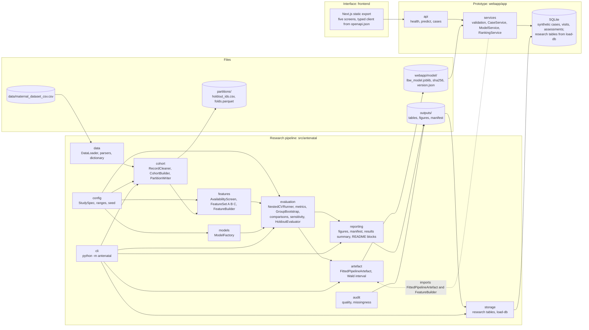
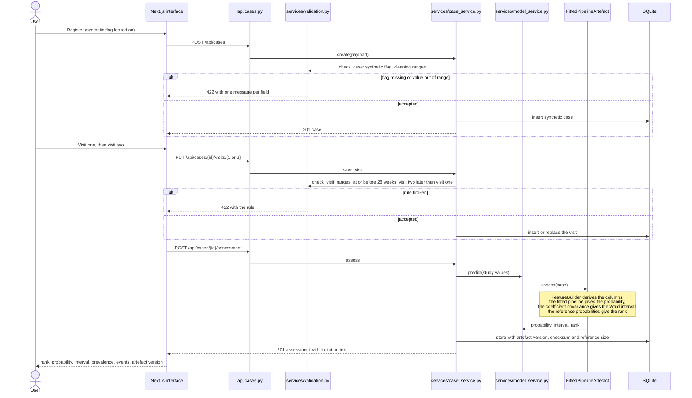
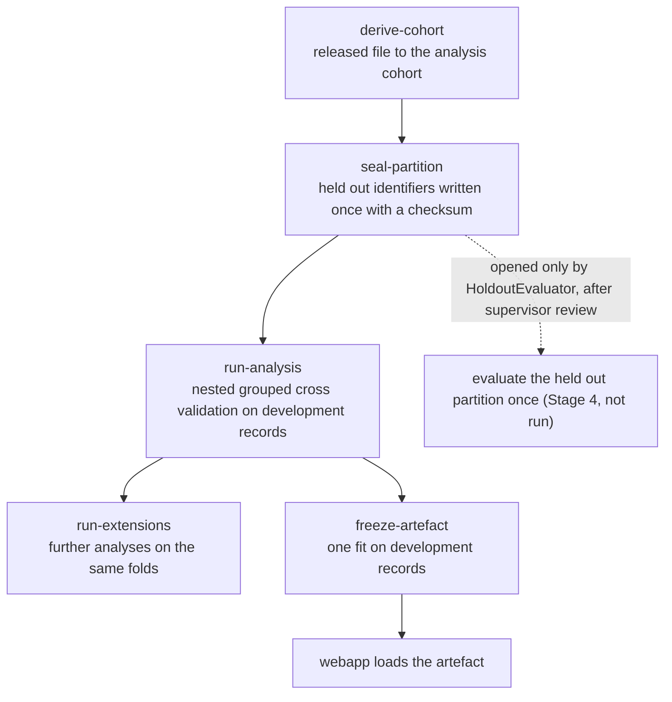

# Architecture

The repository has two parts that share one package. The research pipeline in
`src/antenatal` turns the released file into results and a frozen artefact.
The prototype in `webapp/` loads that artefact and scores synthetic cases with
it. The prototype never trains and never repeats a calculation of its own:
feature construction, the probability, the interval and the rank all come from
the package.

## Modules

Each package has one job, and none reaches into another's internals:

| Package | Responsibility |
| --- | --- |
| `config` | The frozen `StudySpec`: every constant, range and seed. Sensitivity analyses are copies with one field changed |
| `data` | Reading the file after its checksum is verified, and pure parsers for blood pressure, numbers and yes or no fields |
| `audit` | Data quality findings and missingness summaries |
| `cohort` | Cleaning, the eligibility steps of Table 3.5 with an exclusion reason per record, the sealed partition and the outer folds |
| `features` | The outcome blind availability screen and the nested feature sets, chosen per model family by polymorphic `FeatureSet.columns` |
| `models` | Construction of every pipeline: missing value treatment, scaling, estimator and tuning grid |
| `evaluation` | Nested cross validation, metric strategies, paired group bootstrap, detectable difference, sensitivity and extension analyses, and the only gate to the held out partition |
| `artefact` | The fitted development pipeline with its covariance, reference probabilities, checksum and version |
| `reporting` | Figures, the manifest, the results summary and the generated README blocks |
| `storage` | The research side of the data model in SQLite, written by `load-db` |

## Data model

The proposal's data model (Section 3.4.4) has a research side and an interface side. Both live in the application's SQLite file, `webapp/data/app.sqlite3`, which is created locally and not committed.

| Table | Entity | Written by | Uniqueness |
| --- | --- | --- | --- |
| `pregnancy_records` | PREGNANCY_RECORD | `load-db`, from `outputs/cohort_manifest.csv` | one row per record |
| `visit_measurements` | VISIT_MEASUREMENT | `load-db`, cleaned visit one and two values | record and visit number |
| `model_configurations` | MODEL_CONFIGURATION and PIPELINE_ARTEFACT | `load-db`, from each `version.json` and `model_params.json` | version |
| `evaluation_results` | EVALUATION_RESULT | `load-db`, from `outputs/tables/cv_fold_metrics.csv` | model, feature set, repeat and fold |
| `synthetic_cases` | SYNTHETIC_CASE | the prototype | synthetic flag always true |
| `synthetic_visits` | SYNTHETIC_VISIT | the prototype | case and visit number |
| `assessments` | ASSESSMENT | the prototype | references the artefact version and checksum |

Exclusion reasons are columns of `pregnancy_records` (EXCLUSION_LOG), and partition assignments stay in `partitions/` (PARTITION_ASSIGNMENT), so no table records which records are held out. `load-db` drops and rebuilds its four tables, so it can be repeated.

In the prototype, routers validate and route, services decide, the package
computes, and the database stores.

## Request flow for one assessment

A synthetic case is registered, its two visits are recorded, and an assessment is requested.

Before any of this, the application factory in `webapp/app/main.py` creates
`ModelService`, which verifies the artefact's SHA 256. If the file has
changed, `ChecksumMismatch` is raised and the server does not start.

## Analysis flow

The counts on each step are in `outputs/tables/cohort_flow.csv`.
