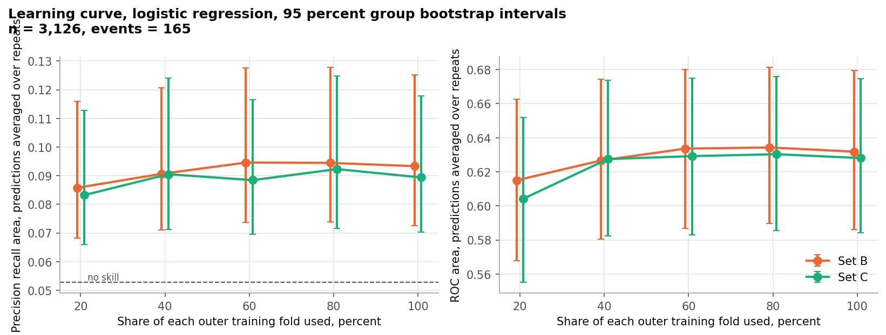

# Evidence for the supervisor meeting

Generated by `python -m antenatal meeting-evidence` from `outputs/tables`. Every number below comes from those files. The held out partition has not been opened.

## Cohort flow (Table 3.5)

| Step | Criterion | Excluded | Remaining | Events remaining |
| --- | --- | --- | --- | --- |
| 0 | Records in the file | 0 | 8817 | 443 |
| 1 | No recorded live birth | 208 | 8609 | 382 |
| 2 | Multiple delivery | 416 | 8193 | 360 |
| 3 | Recorded birth weight outside 1 to 6 kilograms | 32 | 8161 | 360 |
| 4 | Visit one lacks a parsed blood pressure in range or a gestational age in range | 167 | 7994 | 349 |
| 5 | Visit two absent, or lacks a parsed blood pressure in range or a gestational age in range | 1791 | 6203 | 271 |
| 6 | Gestational age at visit two not greater than at visit one | 138 | 6065 | 268 |
| 7 | Visit two later than 28 weeks | 2157 | 3908 | 206 |

## Development and held out counts

| Partition | Pregnancies | Low birth weight events |
| --- | --- | --- |
| Analysis cohort | 3908 | 206 |
| Development partition | 3126 | 165 |
| Held out partition (sealed, not opened) | 782 | 41 |

## Primary and secondary results, both model families

Development records, n = 3,126, events = 165. Group bootstrap of paired averaged out of fold predictions, 2,000 resamples.

| Model | Role | Comparison | Metric | Difference (95 percent interval) | Smallest detectable |
| --- | --- | --- | --- | --- | --- |
| Logistic regression, L2 | primary | C over B (first visit added) | PR AUC | -0.0040 (-0.0130 to +0.0025) | 0.0110 |
| Logistic regression, L2 | secondary | B over A (second visit added) | ROC AUC | +0.0205 (-0.0066 to +0.0476) | 0.0385 |
| Gradient boosted trees | primary | C over B (first visit added) | PR AUC | -0.0066 (-0.0173 to +0.0024) | 0.0144 |
| Gradient boosted trees | secondary | B over A (second visit added) | ROC AUC | +0.0345 (+0.0070 to +0.0627) | 0.0397 |

## Learning curve

## Sensitivity analyses S1 to S6

| Analysis | Specification | Comparison | Metric | Difference (95 percent interval) | n | Events |
| --- | --- | --- | --- | --- | --- | --- |
| S1 | Visit two by 24 weeks | C over B | PR AUC | -0.0035 (-0.0116 to +0.0036) | 1945 | 113 |
| S1 | Visit two by 24 weeks | B over A | ROC AUC | +0.0063 (-0.0214 to +0.0320) | 1945 | 113 |
| S2 | Visit two by 32 weeks | C over B | PR AUC | -0.0033 (-0.0130 to +0.0052) | 4301 | 199 |
| S2 | Visit two by 32 weeks | B over A | ROC AUC | +0.0266 (+0.0031 to +0.0514) | 4301 | 199 |
| S3 | Excluding records marked both term and preterm | C over B | PR AUC | -0.0023 (-0.0114 to +0.0042) | 3079 | 162 |
| S3 | Excluding records marked both term and preterm | B over A | ROC AUC | +0.0206 (-0.0061 to +0.0465) | 3079 | 162 |
| S4 | Every screened measurement recorded at both visits | C over B | PR AUC | -0.0010 (-0.0067 to +0.0046) | 2504 | 144 |
| S4 | Every screened measurement recorded at both visits | B over A | ROC AUC | +0.0129 (-0.0088 to +0.0343) | 2504 | 144 |
| S5 | Rate of change per week added to set C | C rate per week over B | PR AUC | -0.0057 (-0.0162 to +0.0006) | 3126 | 165 |
| S5 | Rate of change per week added to set C | B over A | ROC AUC | +0.0205 (-0.0066 to +0.0476) | 3126 | 165 |
| S6 | Lower birth weight bound relaxed to 0.5 kg | C over B | PR AUC | -0.0040 (-0.0130 to +0.0025) | 3126 | 165 |
| S6 | Lower birth weight bound relaxed to 0.5 kg | B over A | ROC AUC | +0.0205 (-0.0066 to +0.0476) | 3126 | 165 |
| GBT, uniform imputation | Gradient boosted trees with median imputation and indicators | C over B | PR AUC | -0.0074 (-0.0216 to +0.0008) | 3126 | 165 |
| GBT, uniform imputation | Gradient boosted trees with median imputation and indicators | B over A | ROC AUC | +0.0431 (+0.0151 to +0.0727) | 3126 | 165 |

## Missingness finding

| Visit two measurement | Low birth weight percent when recorded | When missing | Missing minus recorded, points |
| --- | --- | --- | --- |
| Weight | 5.3 (4.6 to 6.1), n = 3,116 | 0.0 (0.0 to 27.8), n = 10 | -5.3 (-6.1 to +22.5) |
| Pulse rate | 5.7 (4.9 to 6.7), n = 2,544 | 3.3 (2.1 to 5.0), n = 582 | -2.5 (-4.0 to -0.5) |
| Haemoglobin | 5.0 (3.9 to 6.4), n = 1,213 | 5.4 (4.5 to 6.5), n = 1,913 | +0.4 (-1.3 to +2.0) |

Systolic and diastolic pressure and gestational week are never missing in the cohort, because the eligibility rule requires them.

Missingness indicators, PR AUC with against without: Indicators added, set B: +0.0029 (-0.0088 to +0.0147); Indicators added, set C: +0.0022 (-0.0069 to +0.0114).

Reading: the pulse difference is an association with recording practice, not physiology. Whether a pulse is recorded depends on the clinic, the day and the worker, and with no facility identifier this cannot be separated from differences between clinics. The indicators add no predictive signal that can be told apart from zero.

## Not yet complete

* **Stage 4, single held out evaluation.** Written and tested on synthetic data only. It runs once, after the supervisor confirms the analysis plan has been reviewed, and the run is logged with a timestamp.
* **Stage 6, Next.js prototype.** The current interface is the Stage 3 single page over the API. The Next.js build, the Playwright tests in three browsers, the accessibility scores, the latency benchmark and the regenerated design screens are not started.
* **Stage 7, documentation.** The README, `docs/ARCHITECTURE.md`, `docs/ethics_note.md`, `docs/Technical-Report.md` and `CHANGELOG.md` are written. The report PDF, the demonstration video and the dataset producers' ethics statement are still missing.
* **Docker.** The Dockerfile and compose file exist but have not been run, because Docker is not installed on the development machine.
* **Roadmap.** `docs/Capstone-Finalisation-Roadmap.md` awaits the supervisor facing version.
* **TRIPOD+AI items pending.** Items 2 (abstract), 18a (funding), 18b (conflicts of interest), 18c (protocol location), 18d (registration), 19 (patient and public involvement) and 27c (next steps) need statements from the author. Item 17 (ethical approval) is partly answered because the dataset release states no approval. Item 20c (development against held out distributions) needs Stage 4. See `docs/tripod_ai_checklist.md`.
* **Proposal corrections.** Table 3.8 counts for S1, S4, S5 and S6, and the pulse range in Section 3.3.3. See `docs/deviations.md`.
